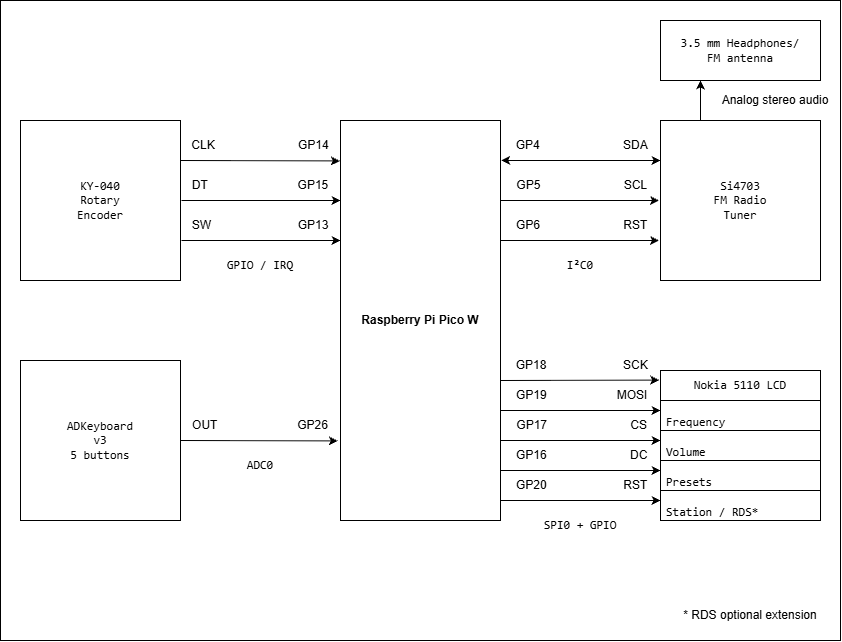

# FM radio receiver with digital tuning

Členové týmu

1. Ekaterina Krupenko (zodpovědná za simulaci ve Wokwi)
2. Rostislav Lacek (zodpovědný za )
4. Vojtěch Kudela (zodpovědný za)

# Teoretický popis

Běžné analogové FM přijímače postrádají přesné digitální ladění frekvence, vizuální zpětnou vazbu o naladěné stanici, dekódování doplňkových textových informací a pohodlnou správu uložených předvoleb. Návrh digitálního rádia na rozšiřující desce DFRobot Pico Gravity Board vyžaduje přesnou časovou koordinaci mezi různými typy sběrnic a vstupů v reálném čase – konkrétně rychlé zpracování impulzů z rotačního enkodéru KY-040, vyhodnocení stisků tlačítek s ošetřením zákmity (debounce), obousměrnou komunikaci s tunerem Si4703 přes I2C sběrnici a plynulé vykreslování grafického rozhraní na LCD displeji Nokia 5110 přes SPI, aniž by docházelo ke zpoždění uživatelského rozhraní nebo výpadkům audio výstupu do sluchátek.

Tento projekt realizuje plně digitální FM přijímač postavený na mikrokontroléru Raspberry Pi Pico W (RP2040) naprogramovaném v jazyce MicroPython. Architektura systému přehledně odděluje obsluhu hardwarových vstupů od aktualizace grafického bufferu a řízení tuneru, což zajišťuje okamžitou a stabilní odezvu na uživatelské povely při zachování optimálního časování celého zařízení.

## Očekávané výsledky

Cílem finálního zařízení je vytvořit plně funkční, stabilní a přenosný rozhlasový přijímač na platformě Raspberry Pi Pico W, který nabídne následující vlastnosti:

* **Spolehlivá hardwarová integrace:** Bezproblémová souhra všech komponent na desce *DFRobot Pico Gravity Board*, včetně stabilního příjmu FM signálu přes tuner *Si4703* a využití sluchátkového kabelu jako vestavěné antény.
* **Intuitivní digitální ovládání:** Plynulé a citlivé ladění frekvence i regulace hlasitosti pomocí rotačního enkodéru *KY-040* doplněné o softwarové ošetření zákmity tlačítek (*debounce*) pro zamezení chybových stisků.
* **Optimalizované grafické rozhraní bez přetékání:** Využití displeje *Nokia 5110* (84×48 pixelů) s precizně spočítanými souřadnicemi, které zcela eliminuje ořezávání textu. Rozhraní přehledně zobrazuje aktuální stav tuneru, frekvenci, název stanice v inverzním zvýrazněném rámečku a dynamický sloupcový graf hlasitosti.
* **Modulární a efektivní software:** Čistá struktura kódu rozdělená do samostatných logických modulů (ovládání displeje, enkodér, komunikace s tunerem).
* **Stabilní časování a reálný čas:** Dodržení plánu souběžnosti a neblokujících intervalů (rychlé čtení enkodéru, periodická aktualizace displeje a pravidelné dotazování RDS přes I2C), což zajišťuje okamžitou odezvu systému bez výpadků audio výstupu.

## Komponenty

| Komponenta | Popis / Specifikace | Rozhraní / Protokol | Poznámky |
| :--- | :--- | :--- | :--- |
| **Raspberry Pi Pico** | RP2040 mikrokontrolér | RP2040 dvoujádrový ARM Cortex-M0+ | 3.3V logická úroveň |
| **FM modul** | Si4703 FM Tuner | I2C + 3,5mm Jack | součástí je zesilovač/ anténa pro sluchátka |
| **displej** | Nokia 5110 Display (PCD8544) | SPI (84x48 Graphic LCD) | podsvícený grafický LCD  |
| **rotační enkodér** | KY-040 | N/A | 3,3V až 5V logická úroveň/ 2 pull-up rezistory|
| **tlačítka** | ADKeyboard v3 | pasivní analogový obvod (odporový dělič napětí) | obsahuje pull-up rezistory |
| **3,5mm sluchátka** | 3,5mm jack | analogové audio | slouží jako anténa |
| **nepájivé pole** | Breadboard a propojovací vodiče | N/A | propojení komponent |

## Popis jednotlivý komponent

### _Příjem a zpracování FM signálu_
Jako klíčový prvek rádiové části **plánujeme využít** integrovaný digitální tuner **Si4703**, jehož úkolem je komunikovat s mikrokontrolérem přes sběrnici I2C a řídicí pin. Od tohoto čipu **očekáváme následující funkce**:
- **Zpracování signálu**: Čip má za úkol zajistit kompletní příjem, demodulaci a stereofonní dekódování FM vysílání v celém pásmu 87,5–108,0 MHz.
- **Dekódování RDS (Radio Data System)**: Od tuneru **očekáváme**, že bude kromě zvuku průběžně číst digitální datový tok RDS a poskytovat softwaru oficiální názvy stanic (např. *EVROPA 2*, *ČRo 1*), které **plánujeme** předávat k zobrazení na displej.
- **Hardwarová regulace hlasitosti**: Tuto funkci **chceme realizovat** digitálně zápisem do vnitřních registrů čipu (v rozsahu 0–15). Od tohoto přístupu **očekáváme** zachování špičkové kvality výstupního signálu bez potřeby vnějšího analogového potenciometru.
- **Anténa**: Jako přijímací FM anténu **plánujeme využít** stínění připojeného audio kabelu od sluchátek.

### _Manuální ladění frekvence_
Pro plynulé a přesné manuální ovládání **budeme používat** rotační enkodér **KY-040** připojený na digitální vstupy. Od tohoto komponentu **očekáváme**:
- **Obsluha v reálném čase**: Snímání otáčení **chceme řešit** pomocí hardwarových přerušení (IRQ) na hranu signálu CLK. Od toho **očekáváme**, že mikrokontrolér spolehlivě zaznamená každý krok enkodéru i při rychlém otočení, aniž by byl ovlivněn překreslováním displeje.
- **Krokování frekvence**: Každý detekovaný impuls má za úkol posunout frekvenci o pevný krok (**0,1 MHz**) a odeslat požadavek na přeladění do čipu Si4703. Integrované tlačítko enkodéru (SW) **plánujeme využít** pro rychlé ztlumení zvuku (Mute).

### _Ovládání hlasitosti a správa předvoleb_
Modul **ADKeyboard v3** sdružující 5 mikrospínačů na jediném analogovém vstupu ADC0 **plánujeme zapojit** za účelem zefektivnění ovládání. Od tohoto modulu **očekáváme** bezproblémové generování unikátních napěťových úrovní. Software **bude zajišťovat** filtraci hodnot (*debouncing*) a rozdělení tlačítek do těchto zamýšlených rolí:
- **Tlačítka 1 a 2 (VOL+ a VOL-)**: **Budou sloužit** k přímé regulaci hlasitosti v registru tuneru s okamžitou zpětnou vazbou na obrazovce.
- **Tlačítka 3 a 4 (UP a DOWN)**: **Plánujeme je využít** k listování v seznamu uložených stanic. Samotný posun kurzoru ještě nemá měnit frekvenci, dokud uživatel volbu nepotvrdí.
- **Tlačítko 5 (OK / ENTER)**: Jeho úkolem **bude** potvrdit výběr zvýrazněné stanice ze seznamu a okamžitě přeladit tuner na tuto frekvenci.

### _Uživatelské rozhraní_
Vizuální zpětnou vazbu **plánujeme zajistit** pomocí LCD displeje **Nokia 5110** (84×48 pixelů) připojeného přes SPI sběrnici. Od displeje **očekáváme**, že přehledně zobrazí následující informace rozdělené do zón:
- **Hlavní údaj o frekvenci**: Výrazné zobrazení aktuálně naladěné frekvence v MHz (např. **105.5 MHz**).
- **Identifikace stanice (RDS / Paměť)**: Vyhrazený řádek pro název stanice získaný z RDS signálu nebo z uložených předvoleb.
- **Indikátor hlasitosti**: Grafický či číselný ukazatel (0–15) reagující na tlačítka hlasitosti.
- **Seznam předvoleb (Preset List)**: Spodní část obrazovky určená k procházení uložených stanic pomocí kurzoru ovládaného tlačítky.

### Blokové schéma

Blokové schéma znázorňuje propojení jednotlivých komponent FM přijímače a použitá rozhraní I²C, SPI, GPIO a ADC.

### Simulace ve Wokwi

V prostředí Wokwi bylo vytvořeno zapojení komponent a vlastní simulace FM modulu Si4703. Byla otestována komunikace I2C a digitální ladění frekvence pomocí MicroPythonu.

**Odkaz na simulaci:** https://wokwi.com/projects/480485965769085953

### Tabulka mapování hardwarových pinů 

| Komponenta | Pin komponenty | Pico Pin Name | Blok / Konektor na desce | Funkce / Popis zapojení |
| :--- | :--- | :--- | :--- | :--- |
| **FM přijímač Si4703** | VCC (3.3V) | 3V3 | Blok **I2C0** (Pin 3V3) | Napájení modulu (3,3 V) |
| | GND | GND | Blok **I2C0** (Pin GND) | Společná zem |
| | SDIO (SDA) | GP4 | Blok **I2C0** (Pin D/4) | I2C datová sběrnice |
| | SCLK (SCL) | GP5 | Blok **I2C0** (Pin C/5) | I2C hodinová sběrnice |
| | RST | GP6 | Vnitřní lišta (GP6) | Resetovací pin pro aktivaci I2C režimu čipu |
| **Nokia 5110 LCD** | VCC | 3V3 | Blok **SPI0** (Pin 3V3) | Napájení displeje (3,3 V) |
| | GND | GND | Blok **SPI0** (Pin GND) | Společná zem |
| | CLK (SCK) | GP18 | Blok **SPI0** (Pin SCK/18) | SPI hodiny (Serial Clock) |
| | DIN (MOSI) | GP19 | Blok **SPI0** (Pin MO/19) | SPI data (Master Out / Data In) |
| | CE (CS) | GP17 | Blok **SPI0** (Pin SS/17) | Chip Select / Aktivace displeje |
| | DC | GP16 | Blok **SPI0** (Pin MI/16) | Přepínání Data / Příkaz (využit MISO pin) |
| | RST | GP20 | Blok **Digital** (Pin GP20) | Hardwarový reset displeje |
| | BL (LIGHT) | 3V3 | Blok **Digital** (Pin GP20 / 3V3) | Podsvícení displeje (připojeno na 3,3 V) |
| **ADKeyboard v3** | VCC | 3V3 | Blok **Analog** (Pin GP26 / 3V3) | Napájení odporové sítě tlačítek (3,3 V) |
| | GND | GND | Blok **Analog** (Pin GP26 / GND) | Společná zem |
| | OUT (S) | GP26 | Blok **Analog** (Pin GP26 / A) | Analogový vstup ADC0 pro čtení 5 tlačítek |
| **Rotační enkodér KY-040** | + (VCC) | 3V3 | Blok **Digital** (Pin GP14 / 3V3) | Napájení pull-up rezistorů enkodéru (3,3 V) |
| | GND | GND | Blok **Digital** (Pin GP14 / GND) | Společná zem |
| | CLK | GP14 | Blok **Digital** (Pin GP14 / D) | Kanál A kvadraturního signálu (pro IRQ) |
| | DT | GP15 | Blok **Digital** (Pin GP15 / D) | Kanál B kvadraturního signálu |
| | SW | GP13 | Blok **Digital** (Pin GP13 / D) | Integrované tlačítko enkodéru (např. pro Mute) |

## Časování

| Činnost | Způsob provedení | Interval | Cíl |
| :--- | :--- | :--- | :--- |
| **Čtení enkodéru (KY-040)** | Hlavní smyčka / Polling | 10–20 ms | Plynulá detekce otáčení hřídele bez ztráty kroků |
| **Ošetření zákmitů tlačítka (Debounce)** | Softwarová detekce / Časové razítko | ~50 ms okno | Zamezení vícenásobného spuštění (double-triggering) při stisku |
| **Obnovení displeje (Nokia 5110)** | Periodická smyčka | Při změně / cca 100 ms | Vizuální zpětná vazba bez blikání displeje |
| **Čtení tuneru (Si4703 / RDS)** | Periodické dotazování | ~300–500 ms | Aktualizace stavu ladění, signálu a názvu stanice přes I2C |

# Požadavky

- [ ] Návrh blokového schématu a případné jeho přepracování do finální verze
- [ ] Otestování samostatných bloků projektu (FM přijímač, LCD displej, enkodér a tlačítka)
- [ ] Sestavení na desku se všemi částmi a její finální otestování
- [ ] Finální zpracování Githubu + README
- [ ] Plakát
- [ ] Demonstrační video

# Plán práce

### 1. Týden
- [x] Zjištění problematiky projektu a domluva na funkcích
- [x] Založení Github repozitáře
- [x] Vytvoření seznamu komponent + přiložit odkazy
- [x] Návrh blokové schématu zapojení (případně jej pak upravit)
- [x] Plán časování

### 2. Týden 
- [ ] Vytvoření a otestování kódu pro displej (pro zobrazení přijímaného signálu -> zobrazení čísel (frekvence a hlasitost))
- [ ] Vytvoření a otestování kódu pro tlačítka (zjistit, jak fungují + datasheet)
- [ ] Vytvoření a otestování kódu pro FM přijímač (rozchodit knihovnu a otestovat v laboratoři)
- [ ] Vytvoření záznamu testovaných částí (foto či video)
- [ ] Uložení funkčních komponentů na Github
- [ ] Aktualizování schématu zapojení (blokové i ve Wowki)

###  3. Týden
- [ ] Sestavení prototypu s klíčovými funkcemi
- [ ] Záznamy a řešené problémy integrace

### 4. Týden
- [ ] Výsledky testů
- [ ] Ověření stability prototypu
- [ ] Návrh plakátu a osnova ukázky

### 5. Týden
- [ ] Kompletní finalizace projektu
- [ ] Dokončení plakátu
- [ ] Dokončení Githubu
- [ ] Natočení demonstračního videa a vložení na Github

## Reference
1. [Gravity: Expansion Board for Raspberry Pi Pico / Pico 2](https://www.dfrobot.com/product-2393.html)
2. [Si4703 FM Radio Receiver](https://pmdway.com/products/si4703-rds-fm-radio-tuner-evaluation-breakout-board?srsltid=AYCX9vKLGemZAaw2HZfW6TDdMDwJ-ylaad4x8F2DHs_wG2OiNv1dP0B4)
3. [Graphic LCD 84x48 - Nokia 5110](https://naylampmechatronics.com/lcd-alfanumerico/989-display-lcd-nokia-5110.html)
4. [ADKeyboard v3](https://botland.store/keyboards/3560-adkeyboard-v3-keyboard-module-with-colorful-buttons-6959420901197.html)
5. [Rotační enkodér KY-040](https://botland.store/encoders/16558-rotation-sensor-encoder-20-pulses-okystar-ky-040-5904422366278.html#product_tab_description)
