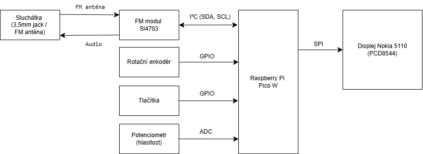

# FM radio receiver with digital tuning

Členové týmu

1. Ekaterina Krupenko (zodpovědná za simulaci ve Wokwi)
2. Rostislav Lacek (zodpovědný za )
4. Vojtěch Kudela (zodpovědný za)

# Teoretický popis a vysvětlení

Běžné analogové FM přijímače postrádají přesné digitální ladění frekvence, vizuální zpětnou vazbu o naladěné stanici, dekódování doplňkových textových informací a pohodlnou správu uložených předvoleb. Návrh digitálního rádia vyžaduje přesnou časovou koordinaci mezi různými typy sběrnic a vstupů v reálném čase – konkrétně rychlé zpracování kvadraturních signálů z rotačního enkodéru, čtení analogových napěťových úrovní z tlačítkové matice, komunikaci s tunerem přes I2C a vykreslování grafiky přes SPI, aniž by docházelo ke zpoždění uživatelského rozhraní nebo výpadkům zvukového výstupu.

Tento projekt realizuje plně digitální FM přijímač postavený na mikrokontroléru Raspberry Pi Pico W (RP2040) naprogramovaném v jazyce MicroPython. Architektura systému odděluje hardwarovou obsluhu vstupů od aktualizace displeje a řízení tuneru, což zajišťuje okamžitou odezvu na uživatelské povely.

## Komponenty

| Komponenta | Popis / Specifikace | Rozhraní / Protokol |
| :--- | :--- | :--- |
| **Raspberry Pi Pico** | RP2040 mikrokontrolér | RP2040 Dvoujádrový ARM Cortex-M0+ / 3.3V logická úroveň |
| **FM Modul** | Si4703 FM Tuner | I2C + 3.5mm Jack |
| **Displej** | Nokia 5110 Display (PCD8544) | SPI (84x48 Graphic LCD) |
| **3.5mm Sluchátka** | analogové audio | zdroj zvuku (funguje jako naténa) |

## Popis funkce jednotlivý komponent

### _Příjem a zpracování FM signálu ()_
Srdcem rádiové části je integrovaný digitální tuner Si4703, který s mikrokontrolérem komunikuje přes sběrnici I2C a řídicí resetovací pin.
- **Zpracování signálu**: Čip se stará o kompletní příjem, demodulaci a stereofonní dekódování FM signálu v pásmu 87,5–108,0 MHz
- **Dekódování RDS (Radio Data System)**: Kromě samotného zvuku přijímač průběžně čte digitální datový tok RDS. Z něj software extrahuje PS (Program Service) – tedy oficiální název aktuálně poslouchané rozhlasové stanice (např. _EVROPA 2_, _ČRo 1_), který se následně předává k zobrazení na displej.
- _Hardwarová regulace hlasitosti_: Nastavení hlasitosti probíhá digitálně zápisem do vnitřních registrů čipu Si4703 (v rozsahu 0–15), čímž je zachována maximální kvalita výstupního signálu bez nutnosti vnějšího analogového potenciometru.
- _Zvukový výstup a anténa_: Demodulovaný audio signál je vyveden přímo na integrovaný 3,5mm stereo jack modulu Si4703 pro připojení sluchátek nebo externího zesilovače. Stínění připojeného audio kabelu zároveň slouží jako přijímací FM anténa.

### _Manuální ladění frekvence ()_
Pro plynulé a přesné manuální přelaďování stanic je použit inkrementální rotační enkodér KY-040 připojený na digitální vstupy CLK a DT.
- _Obsluha v reálném čase_: Snímání otáčení je v MicroPythonu řešeno pomocí hardwarových přerušení (IRQ) na sestupnou/vzestupnou hranu signálu CLK. Díky tomu mikrokontrolér spolehlivě zachytí každý mechanický krok enkodéru i při rychlém otáčení, bez ohledu na to, zda právě překresluje displej.
- _Krokování frekvence_: Každý detekovaný pulz vpravo či vlevo posune naladěnou frekvenci o pevně definovaný krok (standardně **0,1 MHz**) a odešle příkaz k přeladění do modulu Si4703. Integrované tlačítko enkodéru (SW) lze volitelně využít pro rychlé ztlumení zvuku (Mute).

### _Ovládání hlasitosti a správa předvoleb ()_
Modul ADKeyboard v3 sdružuje 5 mikrospínačů na jediný analogový výstup připojený na ADC0 (GP26) mikrokontroléru. Každé tlačítko spíná jiný odporový dělič, takže po stisku vznikne na vstupu ADC unikátní napěťová úroveň (v rozsahu 0–3,3 V). Software tyto hodnoty filtruje (ošetření zákmitů – *debouncing*) a rozděluje tlačítka do tří logických skupin:

- _Tlačítka 1 a 2 (VOL+ a VOL-)_: Slouží k přímé regulaci hlasitosti. Každý stisk inkrementuje nebo dekrementuje aktuální úroveň hlasitosti v registru čipu Si4703 a okamžitě aktualizuje indikátor na obrazovce.

- _Tlačítka 3 a 4 (UP a DOWN – výběr ze seznamu)_: Slouží k listování (posunu kurzoru) v uloženém seznamu předvolených stanic na displeji. Samotné listování ještě nemění naladěnou frekvenci – uživatel si nejprve vybere požadovanou stanici z nabídky.

- _Tlačítko 5 (prostřední tlačítko – OK / ENTER)_: Slouží k potvrzení výběru. Po jeho stisknutí systém načte frekvenci označené stanice ze seznamu předvoleb a okamžitě přeladí tuner Si4703 na tuto stanici.

### _Uživatelské rozhraní ()_
Vizuální zpětnou vazbu zajišťuje monochromatický grafický displej Nokia 5110 (řadič PCD8544) s rozlišením 84×48 pixelů, připojený přes rychlou sběrnici SPI0. Obrazovka je rozdělena do několika přehledných informačních zón:

- _Hlavní údaj o frekvenci_: Dominantní zobrazení aktuálně naladěné frekvence v MHz (např. **105.5 MHz**).

- _Identifikace stanice (RDS / Paměť)_: Řádek zobrazující název stanice dekódovaný ze signálu RDS (pokud je RDS k dispozici), případně uložený název z paměti předvoleb.

- _Indikátor hlasitosti_: Grafický ukazatel (sloupcový graf nebo číselná hodnota VOL: 0–15) reagující na stisk tlačítek VOL+ / VOL-.

- _Seznam předvoleb (Preset List)_: Spodní část displeje zobrazuje položky ze seznamu uložených stanic s vizuálním kurzorem (zvýrazněním), který se pohybuje při ovládání tlačítky na ADKeyboard v3 a čeká na potvrzení prostředním tlačítkem.

### Blokové schéma

Blokové schéma znázorňuje propojení jednotlivých komponent FM přijímače a použitá rozhraní I²C, SPI, GPIO a ADC.

### Simulace ve Wokwi

V prostředí Wokwi bylo vytvořeno zapojení komponent a vlastní simulace FM modulu Si4703. Byla otestována komunikace I2C a digitální ladění frekvence pomocí MicroPythonu.

**Odkaz na simulaci:** https://wokwi.com/projects/480485965769085953

# Požadavky

- [x] Návrh blokového schématu
- [ ] Sestavení na desku + otestování jednotlivých částí (test i součástí kódu)
- [ ] Dokumentace (nastavení dokumentace přes Sphinx API)
- [ ] Výstupy -> finální soubor v README, plakát a ukázkové video

# Plán práce

### 1. Týden
- [x] Zjištění problematiky projektu a domluva na funkcích
- [x] Založení GitLab repozitáře
- [ ] Vytvoření seznamu komponent + přiložit odkazy a datasheety na github
- [x] Návrh blokové schématu zapojení (případně jej pak upravit)

### 2. Týden 
- [ ] Vytvoření a otestování kódu pro displej (pro zobrazení přijímaného signálu -> zobrazení čísel (frekvence a hlasitost))
- [ ] Vytvoření a otestování kódu pro tlačítka (zjistit, jak fungují + datasheet)
- [ ] Vytvoření a otestování kódu pro FM přijímač (rozchodit knihovnu a otestovat v laboratoři)
- [ ] Nahrání funkčních testovacích skriptů do repozitáře

## Reference
1. [Si4703 FM Radio Receiver Hookup Guide](https://learn.sparkfun.com/tutorials/si4703-fm-radio-receiver-hookup-guide).
2. [Graphic LCD 84x48 - Nokia 5110](https://www.sparkfun.com/graphic-lcd-84x48-nokia-5110.html?srsltid=AYCX9vJjXhDt5QJ6w0Y2h9K5h-A4lTs36XpI6SGyjpkp7JnMyYZRqbJC).
3. [ADKeyboard v3](https://botland.store/keyboards/3560-adkeyboard-v3-keyboard-module-with-colorful-buttons-6959420901197.html).
