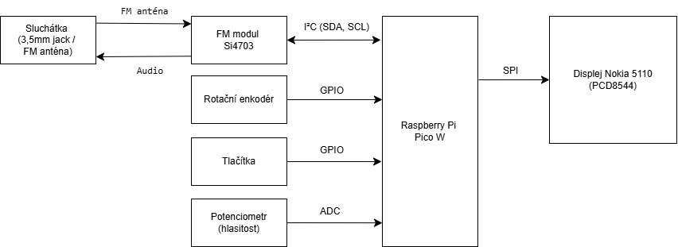

# FM radio receiver with digital tuning

Členové týmu

1. Ekaterina Krupenko (zodpovědná za simulaci ve Wokwi)
2. Rostislav Lacek (zodpovědný za )
4. Vojtěch Kudela (zodpovědný za)

# Komponenty

| Komponenta | Popis / Specifikace | Rozhraní / Protokol |
| :--- | :--- | :--- |
| **Raspberry Pi Pico** | RP2040 mikrokontrolér | RP2040 Dvoujádrový ARM Cortex-M0+ / 3.3V logická úroveň |
| **FM Modul** | Si4703 FM Tuner | I2C + 3.5mm Jack |
| **Displej** | Nokia 5110 Display (PCD8544) | SPI (84x48 Graphic LCD) |
| **3.5mm Sluchátka** | analogové audio | zdroj zvuku (funguje jako naténa) |

### Popis funkce jednotlivý komponent

_FM modul_
- příjem FM signálu pomocí sluchátek připojených k 3.5mm konektoru
- zpracování analogového signálu na digitální

_Displej_
použitý displej by měl být schopen zobrazit:
- aktuálně naladěnou frekvenci
- úroveň hlasitosti
- zobrazení jména stanice (pokud je možno), případně i aktuálně hrané skladby

_Tlačítka_
- 2 tlačítka (levé horní a dolní) budou sloužit k nastavení hlasitosti (VOL+ a VOL-)
- 2 tlačítka (pravé hodní a dolní) budou určena k ladění (UP a DOWN)
- prostřední tlačítko bude sloužit k potvrzování

něco navíc 
- použít i něco dalšího, co nabízí laboratoř a pomocí toho zjišťovat sílu signálu

### Blokové schéma

Blokové schéma znázorňuje propojení jednotlivých komponent FM přijímače a použitá rozhraní I²C, SPI, GPIO a ADC.

### Simulace ve Wokwi

V prostředí Wokwi bylo vytvořeno zapojení komponent a vlastní simulace FM modulu Si4703. Byla otestována komunikace I2C a digitální ladění frekvence pomocí MicroPythonu.

**Odkaz na simulaci:** https://wokwi.com/projects/480485965769085953

# Požadavky

- [x] Návrh blokového schématu
- [ ] Sestavení na desku + otestování jednotlivých částí (test i součástí kódu)
- [ ] Dokumentace (nastavení dokumentace přes Sphinx API)
- [ ] Výstupy -> finální soubor v README, plakát a ukázkové video

# Co je potřeba udělat

### 1. týden
- [ ] Blokové schéma
- [ ] kód pro tlačítka (zjistit, jak fungují + datasheet)
- [ ] kód pro displej (pro zobrazení přijímaného signálu -> zobrazení čísel (frekvence a hlasitost))
- [ ] kód pro FM přijímač (rozchodit knihovnu a otestovat v laboratoři)

## Reference
1. [Si4703 FM Radio Receiver Hookup Guide](https://learn.sparkfun.com/tutorials/si4703-fm-radio-receiver-hookup-guide).
