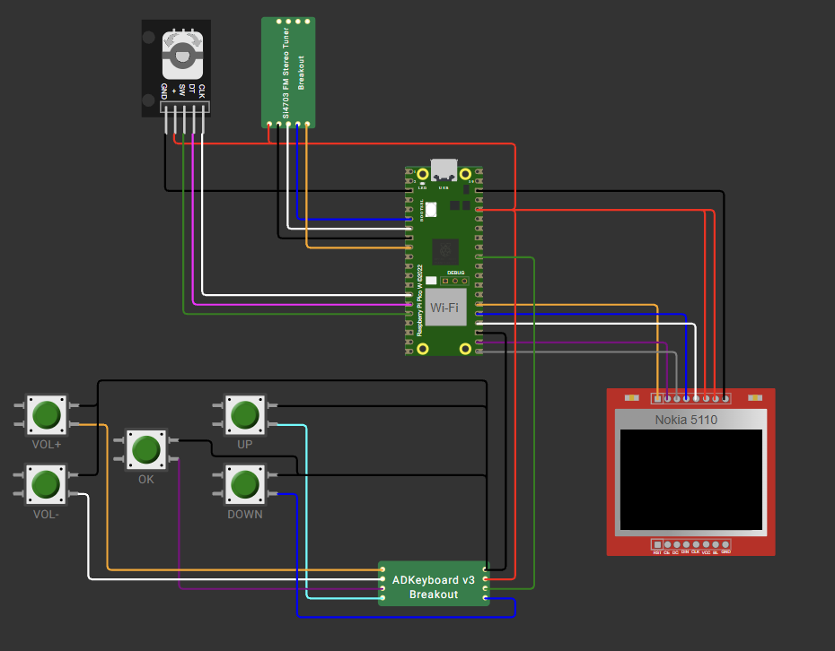

# FM radio receiver with digital tuning

Členové týmu

1. Ekaterina Krupenko (zodpovědná za simulaci ve Wokwi , testování na fyzické desce)
2. Rostislav Lacek (zodpovědný za hardware, fyzické zapojení obvodu na desce a správu GitHub repozitáře)
4. Vojtěch Kudela (zodpovědný za softwarovou architektonickou část, obsluhu FM přijímače a integraci logiky)


# Teoretický popis

Běžné analogové FM přijímače postrádají přesné digitální ladění frekvence, vizuální zpětnou vazbu o naladěné stanici, dekódování doplňkových textových informací a pohodlnou správu uložených předvoleb. Návrh digitálního rádia na rozšiřující desce DFRobot Pico Gravity Board vyžaduje přesnou časovou koordinaci mezi různými typy sběrnic a vstupů v reálném čase – konkrétně rychlé zpracování impulzů z rotačního enkodéru KY-040, vyhodnocení stisků tlačítek s ošetřením zákmity (debounce), obousměrnou komunikaci s tunerem Si4703 přes I2C sběrnici a plynulé vykreslování grafického rozhraní na LCD displeji Nokia 5110 přes SPI, aniž by docházelo ke zpoždění uživatelského rozhraní nebo výpadkům audio výstupu do sluchátek.

Tento projekt realizuje plně digitální FM přijímač postavený na mikrokontroléru Raspberry Pi Pico W (RP2040) naprogramovaném v jazyce MicroPython. Architektura systému přehledně odděluje obsluhu hardwarových vstupů od aktualizace grafického bufferu a řízení tuneru, což zajišťuje okamžitou a stabilní odezvu na uživatelské povely při zachování optimálního časování celého zařízení.

## Očekávané výsledky

Cílem finálního zařízení je vytvořit plně funkční, stabilní a přenosný rozhlasový přijímač na platformě Raspberry Pi Pico W, který nabídne následující vlastnosti:

* _**Spolehlivá hardwarová integrace:**_ Bezproblémová komunikace všech komponent na desce, včetně stabilního příjmu FM signálu přes tuner *Si4703* a využití sluchátkového kabelu jako vestavěné antény.
* _**Intuitivní digitální ovládání:**_ Plynulé a citlivé ladění frekvence i regulace hlasitosti pomocí rotačního enkodéru *KY-040* doplněné o softwarové ošetření zákmity tlačítek (*debounce*) pro zamezení chybových stisků.
* _**Optimalizované grafické rozhraní bez přetékání:**_ Využití displeje *Nokia 5110*, který bude přehledně zobrazovat aktuální stav tuneru, frekvenci, název stanice v inverzním zvýrazněném rámečku a dynamický sloupcový graf hlasitosti.
* _**Modulární a efektivní software:**_ Čistá struktura kódu rozdělená do samostatných logických modulů (ovládání displeje, enkodér, komunikace s tunerem).
* _**Stabilní časování:**_ Dodržení plánu souběžnosti a neblokujících intervalů (rychlé čtení enkodéru, periodická aktualizace displeje a pravidelné dotazování RDS přes I2C), což zajiští okamžitou odezvu systému bez výpadků audio výstupu.


### Hierarchická struktura repozitáře

```text
pico-fm-radio/
├── docs/
│   ├── AN243.pdf
│   ├── DFR0075_sch.pdf
│   ├── Nokia5110.pdf
│   ├── OKY3431.pdf
│   ├── RP-008276-DS-5-getting-started-with-pico.pdf
│   ├── Si4703_Eval_v13.pdf
│   └── Si4703_datasheet.pdf
├── images/
│   ├── FMradio.drawio.png
│   ├── Schéma_zapojení.png
│   ├── blockdiagram.drawio.png
│   └── blockdiagram.png
├── test/
│   ├── si4703Library.py
│   ├── test.py
│   ├── testButtonsEncoder.py
│   └── test_display.py
├── .gitignore
├── LICENSE
└── README.md
```


# Hardware

## Komponenty

| Komponenta | Popis / Specifikace | Rozhraní / Protokol | Poznámky | Odkazy |
| :--- | :--- | :--- | :--- | :--- |
| **Raspberry Pi Pico** | RP2040 mikrokontrolér | RP2040 dvoujádrový ARM Cortex-M0+ | 3.3V logická úroveň | _[`Datasheet`](https://pip-assets.raspberrypi.com/categories/686-raspberry-pi-pico-w/documents/RP-008312-DS-3-pico-w-datasheet.pdf)_ |
| **FM modul** | Si4703 FM Tuner | I2C + 3,5mm Jack | součástí je zesilovač/ anténa pro sluchátka | _[`Datasheet`](https://cdn.sparkfun.com/assets/learn_tutorials/2/7/4/Si4703_datasheet.pdf)_ |
| **displej** | Nokia 5110 Display (PCD8544) | SPI (84x48 Graphic LCD) | podsvícený grafický LCD  | _[`Datasheet`](https://cdn.sparkfun.com/assets/b/1/b/e/f/Nokia5110.pdf)_ |
| **rotační enkodér** | KY-040 | N/A | 3,3V až 5V logická úroveň/ 2 pull-up rezistory| _[`Datasheet`](https://okystar.com/wp-content/uploads/2017/08/OKY3431.pdf)_ |
| **tlačítka** | ADKeyboard v3 | pasivní analogový obvod (odporový dělič napětí) | obsahuje pull-up rezistory | _[`Datasheet`](https://media.digikey.com/pdf/Data%20Sheets/DFRobot%20PDFs/DFR0075_Web.pdf)_ |
| **3,5mm sluchátka** | 3,5mm jack | analogové audio | slouží jako anténa | N/A |
| **nepájivé pole** | Breadboard a propojovací vodiče | N/A | propojení komponent | N/A |


## Popis jednotlivých komponent

### _Příjem a zpracování FM signálu_
Základem rádiové části je integrovaný digitální tuner _[`Si4703`](https://pip-assets.raspberrypi.com/categories/686-raspberry-pi-pico-w/documents/RP-008312-DS-3-pico-w-datasheet.pdf)_, který s mikrokontrolérem komunikuje přes I2C sběrnici a řídicí resetovací pin. 
- ***Zpracování signálu***: Čip obstarává kompletní příjem, demodulaci a stereofonní dekódování FM vysílání v běžném rozhlasovém pásmu 87,5–108,0 MHz. _[`Knihovna`](https://github.com/ryedwards/si4703RaspberryPi)_
- ***Dekódování RDS (Radio Data System)***: Kromě samotného audia přijímač průběžně čte RDS data, ze kterých software vytahuje oficiální názvy stanic (např. *EVROPA 2*, *ČRo 1*) a posílá je na displej.
- ***Hardwarová regulace hlasitosti***: Hlasitost se nastavuje digitálně přímým zápisem do vnitřních registrů čipu (v rozsahu 0–15), což zaručuje čistý výstup bez nutnosti používat vnější analogový potenciometr.
- ***Anténa***: Jako přijímací anténa pro FM signál slouží sluchátkový kabel.


### _Ladění frekvence_
Pro plynulé a přesné manuální ovládání slouží rotační enkodér _[`KY-040`](https://okystar.com/wp-content/uploads/2017/08/OKY3431.pdf)_ připojený na digitální vstupy.
- ***Obsluha v reálném čase***: Snímání otáčení je ošetřeno pomocí hardwarových přerušení (IRQ) na hranu signálu CLK. Díky tomu mikrokontrolér spolehlivě zachytí každý krok enkodéru i při rychlém otočení, aniž by ho zpomalovalo vykreslování grafiky.
- ***Krokování frekvence***: Každý zaznamenaný impuls posune naladěnou frekvenci o pevný krok a odešle příkaz k přeladění do tuneru. Integrované tlačítko enkodéru (SW) navíc funguje jako rychlé prohledávání a naladění stanice.


### _Ovládání hlasitosti a správa předvoleb_
Modul _[`ADKeyboard v3`](https://media.digikey.com/pdf/Data%20Sheets/DFRobot%20PDFs/DFR0075_Web.pdf)_ sdružuje pět mikrospínačů připojených na jediný analogový vstup ADC0. Každé tlačítko aktivuje jiný odporový dělič a vytvoří na vstupu unikátní napěťovou úroveň (0–3,3 V). Software hodnoty filtruje proti zákmitem (*debouncing*) a rozděluje je do těchto funkcí:
- ***Tlačítka 1 a 2 (VOL+ a VOL-)***: Slouží k přímé úpravě hlasitosti v registru tuneru s okamžitou odezvou na obrazovce.
- ***Tlačítka 3 a 4 (UP a DOWN)***: Slouží k listování v seznamu uložených stanic. Samotný posun kurzoru ještě nemění frekvenci, dokud uživatel volbu nepotvrdí.
- ***Tlačítko 5 (OK / ENTER)***: Slouží k potvrzení vybrané stanice ze seznamu, okamžitému přeladění tuneru na tuto frekvenci, případně k uložení stanice do paměti.


### _Uživatelské rozhraní_
Vizuální zpětnou vazbu obstarává LCD displej _[`Nokia 5110`]()_ (84×48 pixelů) připojený přes SPI sběrnici. Informace jsou na obrazovce rozděleny do přehledných zón:
- ***Hlavní údaj o frekvenci***: Výrazné zobrazení aktuálně naladěné frekvence v MHz (např. **105.5 MHz**).
- ***Identifikace stanice (RDS / Paměť)***: Vyhrazený řádek pro název stanice načtený z RDS nebo z uložených předvoleb.
- ***Indikátor hlasitosti***: Grafický či číselný ukazatel (0–15) reagující na stisk tlačítek hlasitosti.
- ***Seznam předvoleb (Preset List)***: Spodní část obrazovky určená k procházení uložených stanic pomocí kurzoru ovládaného tlačítky.


## Schémata

### Blokové  schéma

Blokové schéma znázorňuje propojení jednotlivých komponent FM přijímače a použitá rozhraní I²C, SPI, GPIO a ADC.


### Schéma zapojení




## Tabulka mapování hardwarových pinů 

### _FM přijímač Si4703_

| Pin komponenty | Pico Pin Name | Blok / Konektor na desce | Funkce / Popis zapojení |
| :--- | :--- | :--- | :--- |
| VCC (3.3V) | 3V3 | Blok **I2C0** (Pin 3V3) | Napájení modulu (3,3 V) |
| GND | GND | Blok **I2C0** (Pin GND) | Společná zem |
| SDIO (SDA) | GP4 | Blok **I2C0** (Pin D/4) | I2C datová sběrnice |
| SCLK (SCL) | GP5 | Blok **I2C0** (Pin C/5) | I2C hodinová sběrnice |
| RST | GP6 | Vnitřní lišta (GP6) | Resetovací pin pro aktivaci I2C režimu čipu |

### _Nokia 5110 LCD_

| Pin komponenty | Pico Pin Name | Blok / Konektor na desce | Funkce / Popis zapojení |
| :--- | :--- | :--- | :--- |
| VCC | 3V3 | Blok **SPI0** (Pin 3V3) | Napájení displeje (3,3 V) |
| GND | GND | Blok **SPI0** (Pin GND) | Společná zem |
| CLK (SCK) | GP18 | Blok **SPI0** (Pin SCK/18) | SPI hodiny (Serial Clock) |
| DIN (MOSI) | GP19 | Blok **SPI0** (Pin MO/19) | SPI data (Master Out / Data In) |
| CE (CS) | GP17 | Blok **SPI0** (Pin SS/17) | Chip Select / Aktivace displeje |
| DC | GP16 | Blok **SPI0** (Pin MI/16) | Přepínání Data / Příkaz (využit MISO pin) |
| RST | GP20 | Blok **Digital** (Pin GP20) | Hardwarový reset displeje |
| BL (LIGHT) | 3V3 | Blok **Digital** (Pin GP20 / 3V3) | Podsvícení displeje (připojeno na 3,3 V) |

### _ADKeyboard v3_

| Pin komponenty | Pico Pin Name | Blok / Konektor na desce | Funkce / Popis zapojení |
| :--- | :--- | :--- | :--- |
| VCC | 3V3 | Blok **Analog** (Pin GP26 / 3V3) | Napájení odporové sítě tlačítek (3,3 V) |
| GND | GND | Blok **Analog** (Pin GP26 / GND) | Společná zem |
| OUT (S) | GP26 | Blok **Analog** (Pin GP26 / A) | Analogový vstup ADC0 pro čtení 5 tlačítek |

### _Rotační enkodér KY-040_

| Pin komponenty | Pico Pin Name | Blok / Konektor na desce | Funkce / Popis zapojení |
| :--- | :--- | :--- | :--- |
| + (VCC) | 3V3 | Blok **Digital** (Pin GP14 / 3V3) | Napájení pull-up rezistorů enkodéru (3,3 V) |
| GND | GND | Blok **Digital** (Pin GP14 / GND) | Společná zem |
| CLK | GP14 | Blok **Digital** (Pin GP14 / D) | Kanál A kvadraturního signálu (pro IRQ) |
| DT | GP15 | Blok **Digital** (Pin GP15 / D) | Kanál B kvadraturního signálu |
| SW | GP13 | Blok **Digital** (Pin GP13 / D) | Integrované tlačítko enkodéru (např. pro Mute) |


# Software


## Testování

### Tlačítka a enkodér

Program na testování tlačítka a enkodér naleznte _[`zde`](https://github.com/sirotka/FM-Radio-Receiver-With-Digital-Tuning/blob/main/test/testButtonsEncoder.py)_


### Displej

Program na testování displeje naleznte _[`zde`](https://github.com/sirotka/FM-Radio-Receiver-With-Digital-Tuning/blob/main/test/test_display.py)_

Testovaný kódu pro displej naleznete _[`zde`](https://wokwi.com/projects/481578125263599617)_

### FM přijímač
Program na testování FM přijímače naleznete _[`zde`](https://github.com/sirotka/FM-Radio-Receiver-With-Digital-Tuning/blob/main/test/test_display.py)_

Výstupem je výpis právě naladěné frekvence a nastavené hlasitosti.

### Simulace ve Wokwi
V prostředí Wokwi bylo vytvořeno zapojení všech používaných komponent a vlastní simulace FM modulu Si4703. Byla otestována komunikace I2C a digitální ladění frekvence pomocí MicroPythonu. 

**Odkaz na simulaci naleznete _[`zde`](https://wokwi.com/projects/480485965769085953)_**


## Časování

| Činnost | Způsob provedení | Interval | Cíl |
| :--- | :--- | :--- | :--- |
| **Čtení enkodéru (KY-040)** | Hlavní smyčka / Polling | 10–20 ms | Plynulá detekce otáčení hřídele bez ztráty kroků |
| **Ošetření zákmitů tlačítka (Debounce)** | Softwarová detekce / Časové razítko | ~50 ms okno | Zamezení vícenásobného spuštění (double-triggering) při stisku |
| **Obnovení displeje (Nokia 5110)** | Periodická smyčka | Při změně / cca 100 ms | Vizuální zpětná vazba bez blikání displeje |
| **Čtení tuneru (Si4703 / RDS)** | Periodické dotazování | ~300–500 ms | Aktualizace stavu ladění, signálu a názvu stanice přes I2C |


## Použité knihovny a verze MicroPythonu

- **Verze MicroPythonu:** `v1.28.0` (využité prostředí ve Wokwi: `micropython-20260406-v1.28.0`)
- **Základní vestavěné knihovny:**
  - _[`machine`](https://docs.micropython.org/en/latest/library/machine.html)_ (pro obsluhu SPI, I2C, Pin a ADC)
  - _[`time`](https://docs.micropython.org/en/latest/library/time.html)_ (časové prodlevy a měření ticks)
  - _[`framebuf`](https://docs.micropython.org/en/latest/library/framebuf.html)_ (grafický buffer pro LCD)
- **Externí / převzaté knihovny:**
  - _[`si4703`](https://github.com/ryedwards/si4703RaspberryPi)_ – knihovna byla převzata a upravena pro MicroPython z výše uvedeného GitHub repozitáře


# Požadavky

- [ ] Návrh blokového schématu a případné jeho přepracování do finální verze
- [ ] Otestování samostatných bloků projektu (FM přijímač, LCD displej, enkodér a tlačítka)
- [ ] Sestavení na desku se všemi částmi a její finální otestování
- [ ] Finální zpracování Githubu + README
- [ ] Plakát
- [ ] Demonstrační video


# Plán práce

### 1. Týden
- [x] Zjištění problematiky projektu a domluva na funkcích
- [x] Založení Github repozitáře
- [x] Vytvoření seznamu komponent + přiložit odkazy
- [x] Návrh blokové schématu zapojení (případně jej pak upravit)
- [x] Plán časování

### 2. Týden 
- [ ] Udělat úpravy podle připomínek z excel tabulky
- [x] Vytvoření a otestování kódu pro displej (pro zobrazení přijímaného signálu -> zobrazení čísel (frekvence a hlasitost))
- [x] Vytvoření a otestování kódu pro tlačítka (zjistit, jak fungují + datasheet)
- [x] Vytvoření a otestování kódu pro FM přijímač (rozchodit knihovnu a otestovat v laboratoři)
- [ ] Vytvoření záznamu testovaných částí (foto či video)
- [x] Uložení funkčních komponentů na Github
- [ ] Aktualizování schématu zapojení (blokové i ve Wowki)
- [x] Nahrát knihovnu pro FM příjem3
- [x] Nahrát kód pro tlačítka a enkodér
- [x] Nahrát kód pro displej

###  3. Týden
- [ ] Sestavení prototypu s klíčovými funkcemi
- [ ] Záznamy a řešené problémy integrace

### 4. Týden
- [ ] Výsledky testů
- [ ] Ověření stability prototypu
- [ ] Návrh plakátu a osnova ukázky

### 5. Týden
- [ ] Kompletní finalizace projektu
- [ ] Dokončení plakátu
- [ ] Dokončení Githubu
- [ ] Natočení demonstračního videa a vložení na Github

## Reference
1. [Rasberry Pi Pico Pinout](https://pico.pinout.xyz/)
2. [Arduino rotary encoder uder manual](https://cdn.shopify.com/s/files/1/0672/9409/files/ky-040-rotary-encoder-datasheet-and-tutorial.pdf)

### Osobní zdroje
1. [Gravity: Expansion Board for Raspberry Pi Pico / Pico 2](https://www.dfrobot.com/product-2393.html)
2. [Si4703 FM Radio Receiver](https://pmdway.com/products/si4703-rds-fm-radio-tuner-evaluation-breakout-board?srsltid=AYCX9vKLGemZAaw2HZfW6TDdMDwJ-ylaad4x8F2DHs_wG2OiNv1dP0B4)
3. [Graphic LCD 84x48 - Nokia 5110](https://naylampmechatronics.com/lcd-alfanumerico/989-display-lcd-nokia-5110.html)
4. [ADKeyboard v3](https://botland.store/keyboards/3560-adkeyboard-v3-keyboard-module-with-colorful-buttons-6959420901197.html)
5. [Rotační enkodér KY-040](https://botland.store/encoders/16558-rotation-sensor-encoder-20-pulses-okystar-ky-040-5904422366278.html#product_tab_description)
